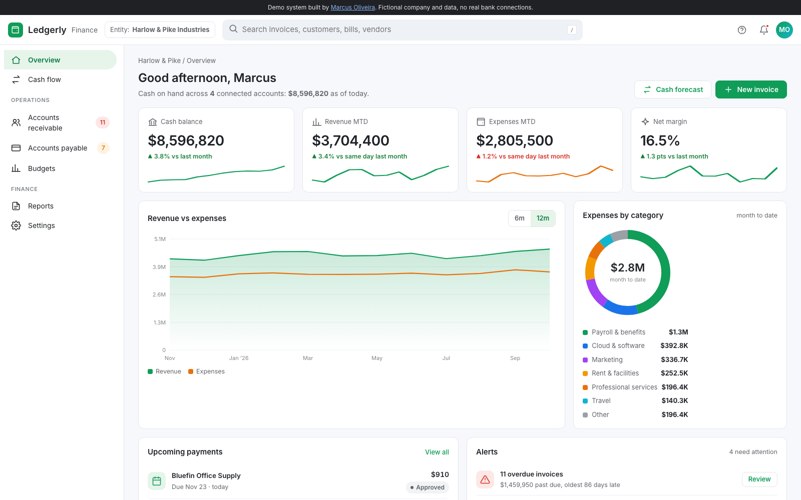

# Ledgerly

Finance management console for a mid-size company: cash position, 13-week forecast, receivables, payables approvals, budgets and P&L reporting in one place.

**Live demo:** https://marcusolive.github.io/ledgerly-finance/

> Portfolio project by [Marcus Oliveira](https://marcusolive.github.io). The company (Harlow & Pike Industries), its customers, vendors and banks are fictional. No real bank is connected and nothing leaves the browser.



## What it shows

| Area | What you can do |
|---|---|
| Overview | Cash balance, revenue and expenses month to date and net margin with sparklines and trends, revenue vs expenses (6m/12m), expenses by category, upcoming payments and alerts for overdue invoices, budget overruns and cash risk |
| Cash flow | Four weeks of actuals plus a 13-week forecast (dashed), minimum cash policy line, base / conservative / optimistic scenarios that recompute every figure, weekly net, inflow and outflow bars and a weekly detail table |
| Accounts receivable | Invoice table with search, status and customer filters, sorting and paging; invoice detail with line items and history; send reminder and mark as paid; aging buckets (0–30, 31–60, 61–90, 90+); DSO; new invoice |
| Accounts payable | Bills move through Pending approval → Approved → Scheduled → Paid; stage cards filter the table; approval limits shown in the bill; payment scheduling with date and source account |
| Budgets | Quarter budget vs actual plus committed per department, red bars above 100%, status badges and an edit budget dialog |
| Reports | Quarterly P&L (revenue, COGS, gross profit, opex, EBITDA, D&A, interest, tax, net income) vs the previous quarter, margins, monthly EBITDA and CSV export |
| Settings | Bank connections with sync and connect flow, reporting currency, fiscal year start, minimum cash policy and approval limit switches |

Global search (shortcut `/`, then `Enter`) jumps to an invoice, customer, bill, vendor or department.

## Stack

- HTML5, CSS3 and vanilla JavaScript (ES2020), no build step and no dependencies
- Shared UI kit (`assets/css/kit.css`, `assets/js/kit.js`): layout shell, SVG charts, data table, modal and toast
- Responsive down to mobile, keyboard shortcut `/` for search, `Esc` closes dialogs, ARIA roles on dialogs, switches and progress bars

## Project structure

```
index.html            page shell and views
assets/css/kit.css    shared design system (console layout, cards, tables, charts)
assets/css/app.css    product-specific styles (workflow, statement, budgets, banks)
assets/js/kit.js      UI kit: icons, charts, table, modal, toast, router
assets/js/data.js     fictional, deterministic sample data
assets/js/app.js      screens and interactions
docs/SPEC.md          functional specification and acceptance criteria
```

## Run locally

```bash
python3 -m http.server 8080
```

Then open http://localhost:8080. Any static server works.

## How it maps to a real system

In production this console would sit on top of:

- A finance API (.NET or Node) over the general ledger, with AR, AP and budget modules
- Bank feeds through an open banking aggregator, reconciled daily against the ledger
- A forecasting service that rolls the 13-week plan forward from open invoices, scheduled bills and payroll
- Approval rules enforced on the server, with an audit trail and SSO with role-based access

## License

[MIT](LICENSE)
